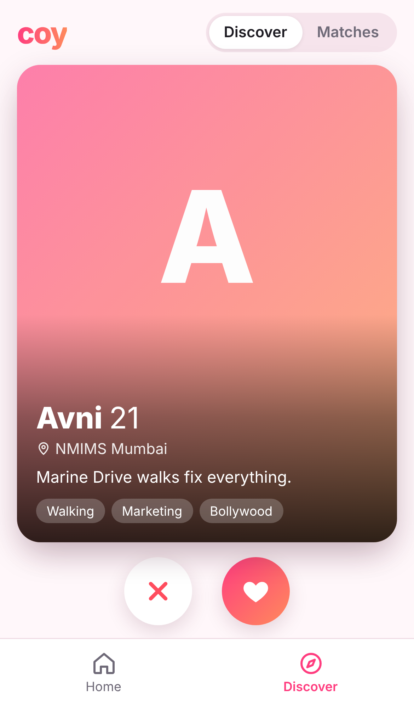
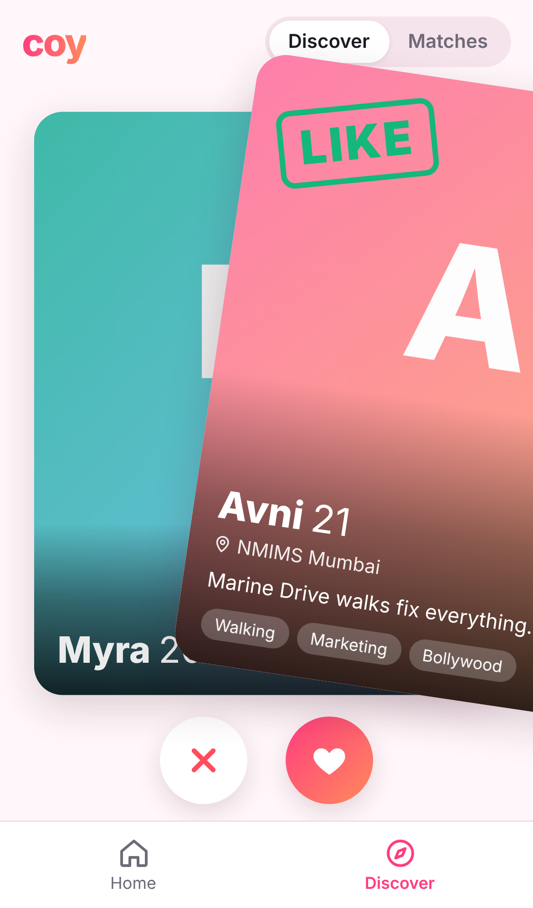
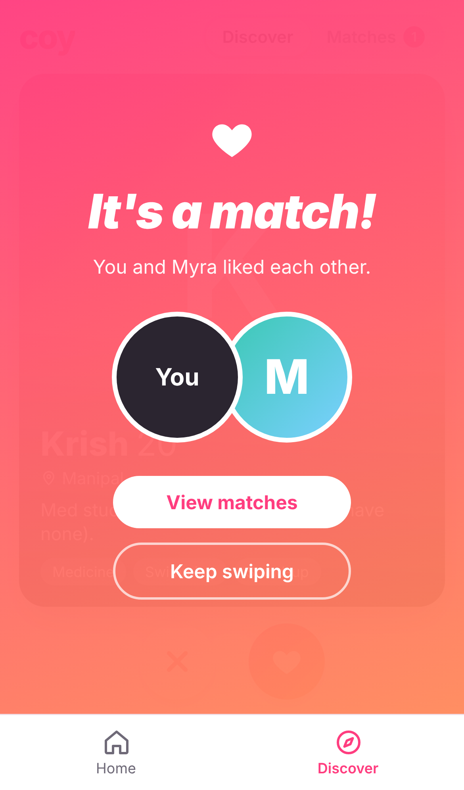
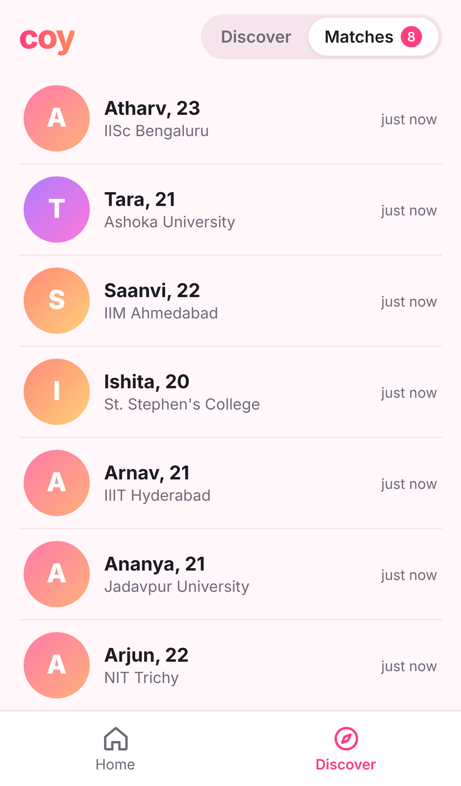
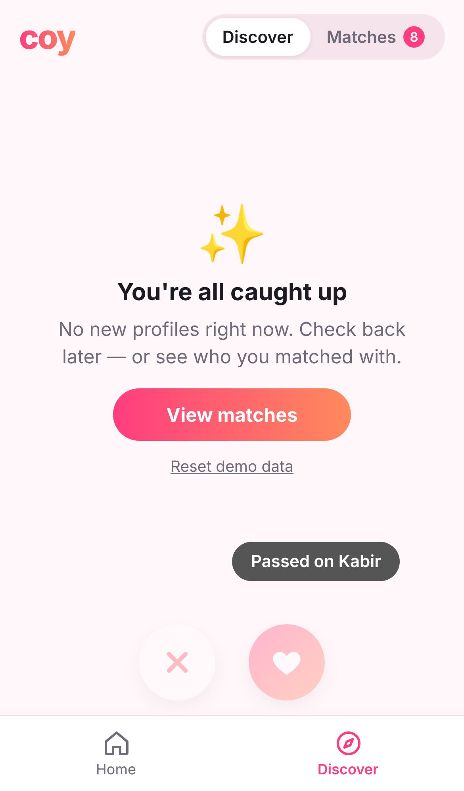

# Coy — Discover tab

A swipe-based **Discover** tab for Coy, built as a standalone Next.js app. There's a blank **Home** tab and a **Discover** tab. In Discover you swipe through profiles, get an "It's a match!" screen when a like is mutual, and see all mutual matches in a list. Likes stay private unless they're mutual.

Part A (two feature suggestions) is in [`PART_A.md`](./PART_A.md).

| Discover | Dragging | It's a match | Matches | Empty |
|---|---|---|---|---|
|  |  |  |  |  |

> The screenshots were taken in a sandbox that couldn't reach the placeholder photo host, so they show the built-in initials fallback. In a normal browser the cards show photos from randomuser.me.

## Run it

```bash
npm install
npm run dev          # http://localhost:3000
npm test             # 37 unit + API tests (Vitest)
npm run build && npm start
npm run reset        # wipe local data; it re-seeds on the next request
```

Requires Node 18.18+. No environment variables or external services are needed.

## Tech stack

- **Frontend:** Next.js 15 (App Router) and React 19, mobile-first, with hand-written CSS. Swipe physics use `framer-motion`.
- **Backend:** Next.js route handlers.
- **Data:** a JSON file at `data/db.json`. It's created and seeded on first run, written atomically (temp file plus rename), and every write goes through one in-process queue so concurrent swipes can't overwrite each other.
- **Auth:** none. There's a single logged-in user with id `me`.

## API

The handlers live under `/api/*`. `next.config.mjs` rewrites the exact paths from the brief to them.

| Method & path | Body | Response |
|---|---|---|
| `GET /feed` | — | `{ profiles: PublicProfile[], remaining }`: profiles the user hasn't swiped on yet |
| `POST /swipe` | `{ targetId, action: "like" \| "pass" }` | `{ matched: false }` or `{ matched: true, profile, matchedAt }` |
| `GET /matches` | — | `{ matches: { profile, matchedAt }[] }`: mutual matches only, newest first |
| `POST /api/reset` | — | Demo helper. Restores the seed data. Disabled in production unless `COY_ALLOW_RESET=1`. |

**Errors:** `400` for invalid JSON, action or target; `404` for an unknown profile; `409 already_swiped` when you try to change a decision. Repeating an identical swipe is **idempotent**, so client retries are safe and a double-tap can't create duplicate swipes or matches. All responses are `Cache-Control: no-store`.

```bash
curl localhost:3000/feed
curl -X POST localhost:3000/swipe -H 'content-type: application/json' -d '{"targetId":"p03","action":"like"}'
curl localhost:3000/matches
```

## Privacy: never reveal who liked you unless it's mutual

This is Coy's core promise, so it's enforced in the backend and covered by tests (`tests/discover.test.ts` → *privacy*):

1. **Allow-listed serialisation.** Profiles leave the server only through `toPublicProfile`. The API never exposes incoming swipes, like counts or a "liked you" flag.
2. **Feed order doesn't leak likes.** If people who liked you were shown first (a common shortcut to make matches happen), the deck order alone would reveal them. Here the order is a stable hash of *(viewer, profile id)*. It doesn't change on reload, and a test proves it's identical whether nobody, some people or everyone liked the user.
3. **Responses that can't be told apart.** A pass always returns `{ matched: false }`. A like that isn't returned gives exactly the same response whether the other person never swiped or passed. A `409` looks the same for admirers and non-admirers.
4. **No probing.** You can't change a decision from pass to like. That stops "pass, then like to check" tricks and keeps each decision final, which is also what "a swiped profile never appears again" requires.
5. **Matches are mutual only.** A test likes every profile and checks that the matches equal exactly the seeded admirers.

## Seed data

There are 32 profiles with name, age, photo, bio, city or college, and interests (`lib/seed.ts`). Eight of them (`SEEDED_ADMIRERS`) have already liked the user, so matches happen naturally during a demo. They're mixed through the deck, not stacked at the front.

## UX details

- One card at a time, with a peek at the next card underneath.
- **Mobile:** drag the card. It tilts as you drag, and LIKE / NOPE stamps fade in. Past 110 px, or with a fast flick, the card flies off. Otherwise it springs back.
- **Desktop:** ✕ and ♥ buttons, plus ← / → keys.
- Each swipe shows a toast ("You liked Aanya" / "Passed on Kabir"). A mutual like opens the full-screen "It's a match!" dialog, which has focus management and closes with Esc.
- Swipes are optimistic. If the request fails, the card comes back and an error toast appears.
- There's a loading skeleton, an error state with retry, an "all caught up" empty state and an empty state for no matches.
- The selected tab survives a reload (`#home` / `#discover`). Respects `prefers-reduced-motion`.

## Project structure

```
app/
  page.tsx               tab bar (Home | Discover)
  api/{feed,swipe,matches,reset}/route.ts
components/              Discover, SwipeCard, MatchModal, Matches, Avatar, icons
lib/
  discover.ts            pure domain logic: feed, swipe/match, matches, validation
  store.ts               JSON-file store (atomic writes, serialised mutations)
  seed.ts                mock profiles and seeded admirers
  types.ts, http.ts, client.ts
tests/
  discover.test.ts       domain and privacy tests
  api.test.ts            route handlers against a temp DB: persistence, concurrency, errors
```

The domain logic is plain functions over the state object with no I/O, which keeps it easy to test. Swapping the JSON file for SQLite or Postgres would only touch `store.ts`.

## Trade-offs and next steps

- A JSON file and an in-process queue work for one server instance. To scale out, move to a real database with a unique `(from, to)` constraint on swipes and create matches in a transaction.
- Deploying on serverless hosts such as Vercel needs a persistent store because their filesystem is read-only. Run it with `npm start` on any Node host instead.
- Possible additions: undo for the last pass (with an anti-probing cooldown), feed pagination, real auth and multiple users.
